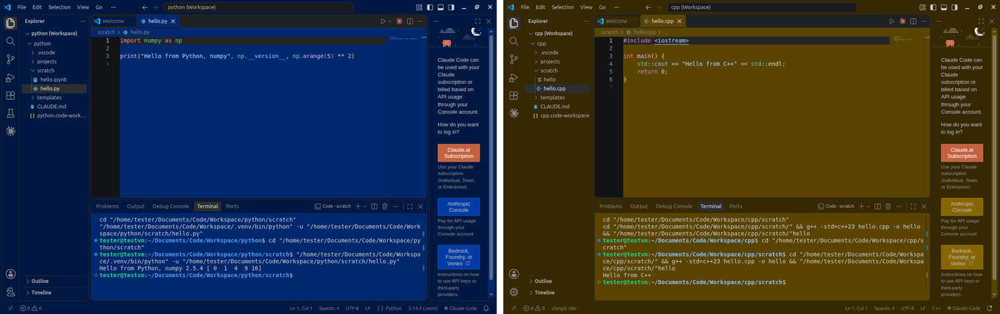
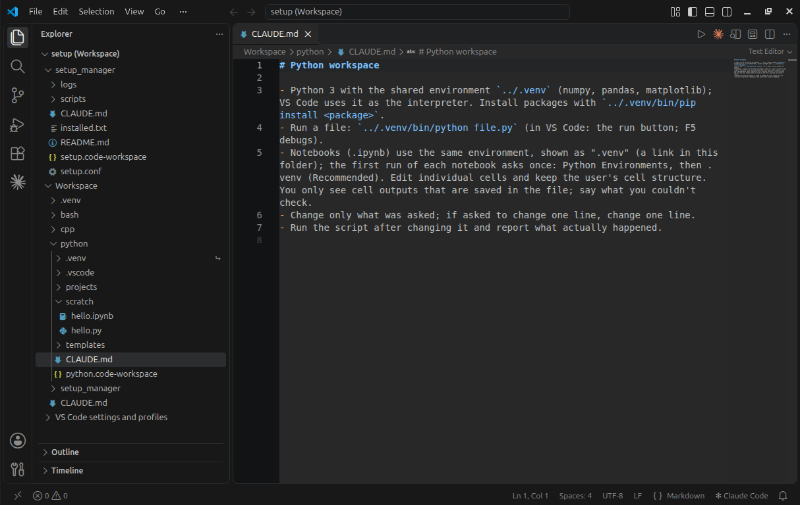

# one-script-vscode

One script that turns a computer into a working VS Code setup: pick your languages, wait, start programming.
Each language gets its own colour-coded VS Code profile and folder, with Claude Code built in.



| Language | What you get |
|---|---|
| Python | Python 3, debugger, Jupyter notebooks, a ready environment (numpy, pandas, matplotlib) |
| C++ | Compiler (C++23), clangd code help, debugger |
| LaTeX | TeX distribution and LaTeX Workshop: the PDF builds on save (large download) |
| Bash | Shell scripts with ShellCheck (Git Bash on Windows) |
| Rust | Toolchain via rustup, rust-analyzer, debugger |

**Claude Code needs a paid Claude plan or an API account.** Everything else works without one.

## Start

You need Ubuntu, Debian or another apt-based Linux, Windows 10 (1809 or later) or 11 (not in S mode), or an Apple
Silicon Mac; the right to install software; internet; several GB of free disk space.

Download the file for your system (open it, then use the download button above its text):
[Linux](setup-workspace.sh), [Windows](setup-workspace.ps1), [macOS](setup-workspace-mac.sh).

**Linux:** open a terminal and run:

```bash
bash ~/Downloads/setup-workspace.sh
```

**Windows:** right-click the Start button, choose "Terminal" ("Windows PowerShell" on Windows 10), paste this and
press Enter:

```
powershell -ExecutionPolicy Bypass -File "$HOME\Downloads\setup-workspace.ps1"
```

**macOS:** open Terminal (Cmd+Space, "Terminal") and run the command below. Allow access to Downloads if asked; the
password is your Mac login password (nothing shows while you type). **It has never run on a real Mac**, only in a
simulator, so expect rough edges.

```bash
bash ~/Downloads/setup-workspace-mac.sh
```

A window asks for your languages, then a summary shows the sizes; nothing is installed until you confirm. The install
takes 10 minutes to over an hour (LaTeX is the big one), and the last window says which languages work. Then start
**VS Launcher** from the app menu, Start menu or Spotlight, pick a workspace and sign in to Claude Code in its panel.

**Bypass mode:** by default Claude Code edits files and runs commands without asking for permission first. To make
it ask, choose that in the setup's window or add `--no-bypass` (`-NoBypass` on Windows). Later: the VS Code setting
"Claude Code: Initial Permission Mode".

## If something goes wrong

If a language fails, the others carry on and the last window says why. Fix the cause and run the script again (it
only adds what is missing), or open **Setup Manager** in VS Launcher and ask Claude. On Windows, antivirus software
can block single steps; a second run usually finishes.

To report a problem, type `/test-setup` in Setup Manager's Claude panel, then open an issue here and attach its
report (or, if the install stopped early, the newest log from `setup_manager/logs/`).

## What it changes

```
Code/                      in Documents on Linux, in your home folder on Windows and macOS
  launcher                 VS Launcher
  Workspace/
    CLAUDE.md              rules Claude follows in every workspace
    python/, cpp/, ...     scratch/ (a hello file to try), projects/, templates/, CLAUDE.md (the language's rules)
    setup_manager/         README.md (the guide to your setup), what was installed, logs
```



It installs programs with apt (switching on Ubuntu's `universe` source if needed), winget or Homebrew. It adds the
VS Code profiles (your existing settings are backed up and your default profile stays as it is), the launcher, three
Claude Code skills and PATH entries where needed, and marks the Workspace folder as trusted in VS Code. It sends
nothing about you.

## More

- Run the script again with `--add rust` to add a language or `--check` to test them again. `--help` lists all
  options (Windows: `-Add`, `-Check`, `-Help`).
- To remove it, run the copy in `setup_manager/scripts/` with `--uninstall` (`-Uninstall`) and tick what goes. It
  only touches what the setup installed, and removed folders go to `Code/Trash/`. Your Claude login stays.
- Tested on Ubuntu and Windows 11 (virtual machines and one real laptop each) and Linux Mint; macOS only in a
  simulator. Details and known limitations: [TESTING.md](TESTING.md).

MIT licence, see [LICENSE](LICENSE). Not affiliated with Anthropic or Microsoft.
